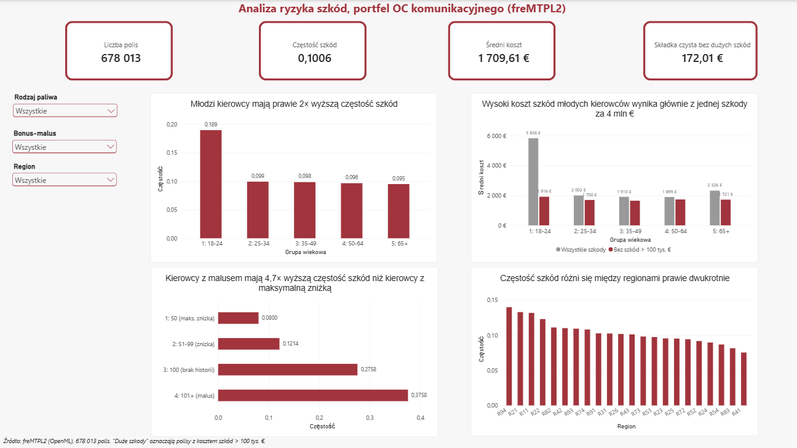
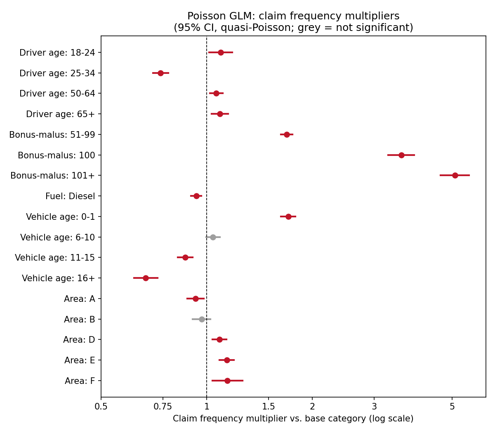

# Motor Insurance Claims — Risk Analysis (freMTPL2)

> **Status: complete.** SQL analysis, Power BI dashboard and Poisson GLM frequency model.

## Overview

Analysis of ~678,000 French motor third-party liability policies to find out which customer segments drive claim frequency, claim severity and expected claim cost (pure premium).

End-to-end pipeline: **Python** (data acquisition) → **SQL Server** (data quality, cleaning, segment analysis) → **Power BI** (dashboard) → **Python** (Poisson GLM).

## Business questions

1. How often do policyholders make claims, and how much does an average claim cost?
2. Which customer segments (driver age, fuel type, bonus-malus, vehicle, region) carry higher risk?
3. How sensitive are the results to rare, very large claims?
4. Which risk factors remain important when they are analysed together rather than one at a time?

## Tech stack

- **Python 3**: pandas, scikit-learn (data acquisition), SQLAlchemy + pyodbc (SQL Server connection), statsmodels (GLM), matplotlib
- **Microsoft SQL Server / T-SQL**: data quality checks, cleaning, analysis (CTEs, window functions, conditional aggregation, views)
- **Power BI / DAX**: interactive dashboard (measures with `CALCULATE`, `ALLSELECTED`, `DIVIDE`)

## Data

[freMTPL2](https://www.openml.org/d/41214) (French Motor Third-Party Liability), a public dataset widely used in actuarial literature, loaded from OpenML:

- `freMTPL2freq` (OpenML id 41214): 678,013 policies with risk characteristics, exposure and number of claims
- `freMTPL2sev` (OpenML id 41215): individual claim amounts, linked to policies by `IDpol`

All amounts are in EUR.

| Column | Description |
|---|---|
| `IDpol` | Policy ID |
| `ClaimNb` | Number of claims in the observation period |
| `Exposure` | Time the policy was in force, in years (0–1) |
| `ClaimAmount` | Total claim cost of the policy (EUR), summed from `freMTPL2sev` |
| `DrivAge` | Driver age |
| `BonusMalus` | Bonus-malus coefficient: 50 = maximum discount, 100 = base level, >100 = surcharge |
| `VehAge`, `VehPower`, `VehBrand`, `VehGas` | Vehicle characteristics |
| `Area`, `Density`, `Region` | Location |

## Repository structure

```
├── README.md
├── python/
│   ├── 01_load_and_merge.py
│   ├── 02_frequency_model.py
│   ├── glm_results.csv
│   └── glm_multipliers.png
├── sql/
│   ├── 01_data_quality_checks.sql
│   ├── 02_policy_clean.sql
│   ├── 03_segment_analysis.sql
│   └── 04_vw_policy_bi.sql
└── powerbi/
    ├── insurance_claims_dashboard.pbix
    └── dashboard.png
```

## How to reproduce

The data files are not stored in this repository (the merged CSV is too large and the data is publicly available).

1. Run `python/01_load_and_merge.py` — it downloads both datasets from OpenML, merges them and saves `fremtpl2_full.csv`.
2. Import the CSV into SQL Server as table `fremtpl2_full` (e.g. with the SSMS *Import Flat File* wizard).
3. Run the scripts in `sql/` in numerical order.
4. Run `python/02_frequency_model.py` (set the server and database name at the top of the script).

## Key metrics

- **Claim frequency** = Σ ClaimNb / Σ Exposure (claims per policy-year)
- **Severity** = Σ ClaimAmount / Σ ClaimNb, calculated only on claims with a recorded amount
- **Pure premium** = frequency × severity (expected claim cost per policy-year)

## Data quality and cleaning decisions

The raw table (`fremtpl2_full`) is kept untouched; all corrections are applied in a separate table (`policy_clean`).

| Issue | Finding | Decision |
|---|---|---|
| Claims without amount | 9,116 policies with `ClaimNb > 0` but `ClaimAmount = 0`, i.e. **26.76% of policies with a claim** | Kept in frequency analysis, excluded from severity analysis (`flag_no_amount`) |
| Exposure above one year | Maximum 2.01 in a one-year dataset | Capped at 1 |
| Extreme claim counts | Maximum 16 claims on one policy | Capped at 4 (original value kept in `ClaimNb_raw`) |
| Text formatting | `VehGas` values contained literal quotes (`'Diesel'`) | Quotes removed |
| Float precision | `Exposure` stored as e.g. 0.100000001490116 | Converted to `DECIMAL` |
| Large claims | 42 policies with total claim cost above €100k; the largest €4.08M | Kept and flagged (`flag_duza_szkoda`); results shown with and without them |

**Deviation from the common reference approach:** capping of `ClaimNb` and `Exposure` follows scikit-learn's [Tweedie regression example](https://scikit-learn.org/stable/auto_examples/linear_model/plot_tweedie_regression_insurance_claims.html) on this dataset. That example also sets `ClaimNb` to 0 for claims without an amount. This project does not, because those claims make up over a quarter of all claims; removing them would understate claim frequency by roughly 25%.

## Power BI dashboard



One-page dashboard built on `vw_policy_bi` (Import mode). All measures are kept in a dedicated `_Miary` table: claim frequency, average severity with and without large claims, pure premium and share of claims (`CALCULATE` + `ALLSELECTED`). Slicers for fuel type, bonus-malus group and region; all visuals cross-filter each other. Before building the visuals, the DAX measures were reconciled with the SQL results.

## Segment analysis (one factor at a time)

### Portfolio level

- Claim frequency: **0.1006** (about 1 claim per 10 policy-years)
- Average severity: **€2,268.77**
- Pure premium: **≈ €228** per policy-year

### Driver age

| Age group | Policies | Frequency | Severity (all claims) | Severity (excl. policies >€100k) |
|---|---|---|---|---|
| 18–24 | 30,198 | 0.189 | €5,836 | €1,916 |
| 25–34 | 140,947 | 0.099 | €2,002 | €1,700 |
| 35–49 | 252,216 | 0.098 | €1,910 | €1,650 |
| 50–64 | 181,580 | 0.096 | €1,899 | €1,734 |
| 65+ | 73,162 | 0.095 | €2,326 | €1,721 |

- Drivers aged 18–24 have about **2× higher claim frequency** than any other age group.
- Their very high average severity (€5,836) is driven mostly by **a single €4.08M claim**, which accounts for about 35% of the group's total claim cost. Excluding claims above €100k, young drivers' claims are about 13% more expensive than those of the 25–34 group.
- Pure premium excluding large claims: **≈ €363 for 18–24 vs ≈ €162 for 35–49** — about 2.2× higher, driven mainly by frequency rather than severity.
- The higher severity of the 65+ group also disappears once large claims are excluded.

### Fuel type

| Fuel | Policies | Frequency | Severity (all claims) | Severity (excl. policies >€100k) |
|---|---|---|---|---|
| Diesel | 332,136 | 0.0975 | €2,052 | €1,701 |
| Regular | 345,877 | 0.1034 | €2,494 | €1,719 |

- Petrol (Regular) vehicles show about 6% higher claim frequency.
- The 22% severity gap is driven by large claims: once they are excluded, severity is practically the same for both fuel types (about 1% difference).
- Pure premium excluding large claims: ≈ €178 for Regular vs ≈ €166 for Diesel — about 7% higher, driven entirely by frequency.

### Cross-segment observation

Across all segments analysed, differences in average severity largely disappear once the 42 largest claims are excluded; the only remaining notable gap is for drivers aged 18–24 (about 13%). **Differences in risk between segments are driven mainly by claim frequency, not by claim size**, while severity is dominated by a small number of very large claims.

### Bonus-malus

| Bonus-malus | Policies | Share | Claim frequency |
|---|---|---|---|
| 50 (maximum discount) | 384,156 | 56.7% | 0.080 |
| 51–99 (partial discount) | 266,533 | 39.3% | 0.121 |
| 100 (base level, no history) | 19,530 | 2.9% | 0.276 |
| above 100 (surcharge) | 7,794 | 1.1% | 0.376 |

- Drivers with a surcharge have **4.7× higher claim frequency** than drivers with the maximum discount: past claims are a strong predictor of future claims.
- Drivers at the base level (100), mostly new drivers without a claims history, have 3.4× higher frequency than those with the maximum discount.

### Region

- Claim frequency differs between regions almost twofold: from **0.140 in R94** to **0.075 in R41** (1.9×).
- Regions differ a lot in size, so results for small regions may partly reflect random variation.

## Claim frequency model (Poisson GLM)

The segment results above look at one factor at a time. Because factors are related (young drivers rarely have the maximum bonus-malus discount), a multivariate model was fitted to separate their effects.

**Method**

- Poisson GLM with log link, fitted in `statsmodels` on all 678,013 policies.
- `log(Exposure)` as offset, so the model estimates claims per policy-year and short policies do not look artificially safe.
- Five categorical variables: driver age, bonus-malus group, fuel type, vehicle age and area. The base category of each variable is the one with the largest exposure.
- `exp(β)` is read as a frequency multiplier relative to the base category, with all other characteristics held constant.
- **Overdispersion:** Pearson χ² / df = 2.49, so the variance is about 2.5× larger than a Poisson model assumes. Standard errors were therefore scaled by the dispersion (quasi-Poisson). Coefficients are unchanged; confidence intervals are wider and p-values higher. All results below come from the quasi-Poisson fit.



**One-factor (raw) vs. model multipliers**

| Category (base) | Raw multiplier | Model multiplier (95% CI) |
|---|---|---|
| Driver age 18–24 (35–49) | 1.93 | **1.10** (1.02–1.18) |
| Driver age 25–34 (35–49) | 1.01 | **0.74** (0.70–0.78) |
| Driver age 50–64 (35–49) | 0.98 | 1.07 (1.02–1.11) |
| Driver age 65+ (35–49) | 0.97 | 1.09 (1.03–1.15) |
| Bonus-malus 51–99 (50) | 1.52 | **1.69** (1.63–1.76) |
| Bonus-malus 100 (50) | 3.45 | **3.58** (3.29–3.90) |
| Bonus-malus 101+ (50) | 4.70 | **5.10** (4.64–5.59) |
| Diesel (Regular) | 0.94 | 0.93 (0.90–0.97) |
| Vehicle age 0–1 (2–5) | 1.76 | 1.71 (1.63–1.79) |
| Vehicle age 16+ (2–5) | 0.69 | 0.67 (0.62–0.72) |
| Area F (C) | 1.47 | 1.15 (1.04–1.26) |

Full results: [`python/glm_results.csv`](python/glm_results.csv).

**Key findings**

- **Bonus-malus is by far the strongest risk factor.** Drivers with a surcharge have about 5× higher claim frequency than drivers with the maximum discount, other characteristics being equal. Its effect *increased* after controlling for driver age.
- **Most of the young-driver effect is explained by bonus-malus.** Raw frequency of drivers aged 18–24 is 1.93× that of the 35–49 group; at the same bonus-malus level the difference falls to 1.10×. Young drivers are riskier, but mostly because they have not yet earned a discount.
- **Drivers aged 25–34 come out 26% safer than 35–49 at the same bonus-malus level.** The likely reason is that the same bonus-malus value means different things at different ages: a 30-year-old with a partial discount is usually still building it up, while a 45-year-old with the same value has probably lost the discount after a claim. This suggests an age × bonus-malus interaction.
- **Vehicle age is the second strongest factor:** new vehicles (0–1 year) have 71% higher claim frequency than vehicles aged 2–5; vehicles 16+ years old have 33% lower frequency.
- **Claim frequency rises with population density** (Area A → F), but the effect shrinks once other factors are taken into account (Area F: 1.47× raw, 1.15× in the model).
- **The fuel effect is stable:** diesel has about 7% lower frequency than petrol both in the raw data and in the model.
- **Correcting for overdispersion matters:** vehicle age 6–10 looked significant in the plain Poisson model (p = 0.005) but not after the correction (p = 0.077). Area B is not significant either (p = 0.258).

## Limitations

- **Missing claim amounts.** 9,116 policies (26.76% of policies with a claim) have a claim but no claim amount in the data. These claims are counted in claim frequency but not in average claim cost. The pure premium therefore assumes that they cost the same as an average claim. If they were actually cheaper or more expensive, the true cost would be different — the data does not allow us to check this.
- **No interactions in the model.** The model assumes that each factor has the same effect regardless of the others. The driver age 25–34 result suggests that the effect of bonus-malus depends on age, which an interaction term would capture.
- **Frequency only.** The model covers claim frequency, not claim severity, so it does not yet produce a full pure premium.
- **Large-claim threshold.** The €100k threshold for "large claims" is my own choice, not an industry standard. It applies to the total claim cost of a policy: if a policy had several claims, their amounts are added together.

## Next steps

- Age × bonus-malus interaction in the frequency model
- Severity model (e.g. Gamma GLM) and pure premium = frequency × severity
- Comparison of the GLM with a gradient boosting model

## Author

Joanna Gyurkovich · [asia.gyurkovich@gmail.com](mailto:asia.gyurkovich@gmail.com)
